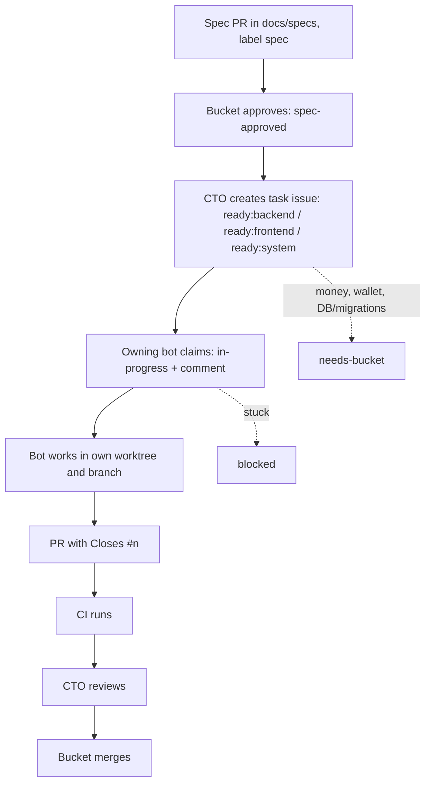

# Specs and task flow

1. Open a spec PR in `docs/specs/` and label it `spec`.
2. Bucket reviews and approves it by adding `spec-approved`.
3. The CTO creates task issues from the approved spec, labelled `ready:backend`, `ready:frontend` or `ready:system`.
4. The owning bot claims a task by swapping its `ready:*` label for `in-progress` and commenting. It works in its own worktree and branch, then opens a PR containing `Closes #n`.
5. CI runs and the CTO reviews the PR.
6. Bucket merges. Bots never merge or push to `main`.

Add `needs-bucket` to work touching money, wallets or DB/migrations. Mark work `blocked` when stuck.

