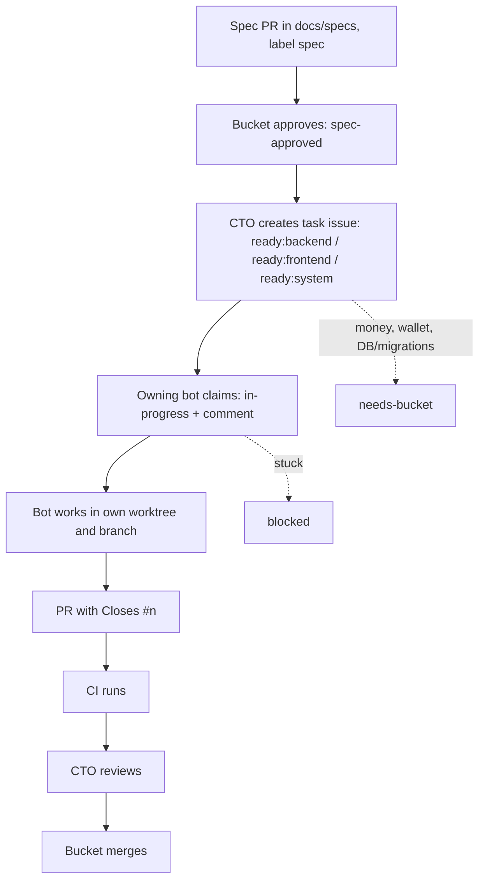

# Specs and task flow

For agent roles, repository areas, local workflow and safety rules, see the [AI-agent team onboarding guide](../team/README.md).

1. Open a spec PR in `docs/specs/` and label it `spec`.
2. Bucket reviews and approves it by adding `spec-approved`.
3. The CTO creates task issues from the approved spec, labelled `ready:backend`, `ready:frontend` or `ready:system`.
4. The owning bot claims a task by swapping its `ready:*` label for `in-progress` and commenting. It works in its own worktree and branch, then opens a PR containing `Closes #n`.
5. CI runs and the CTO reviews the PR.
6. Bucket merges. Bots never merge or push to `main`.

Add `needs-bucket` to work touching money, wallets or DB/migrations. Mark work `blocked` when stuck.

A `ready:*` label is the go-ahead for work outside money, wallet or DB changes; those still need `needs-bucket`. Apply a DB migration only after Bucket explicitly says yes on the issue; merging the PR is not approval.

Before frontend work starts, shared API types must land in `packages/shared` in their own small PR. Link that PR as a dependency in the frontend issue.

When a spec gets `spec-approved`, and when a `needs-bucket` PR merges, the acting bot posts a one-line comment starting with `Decision:` on the spec PR, issue or PR so Ledger can log it to Notion.

