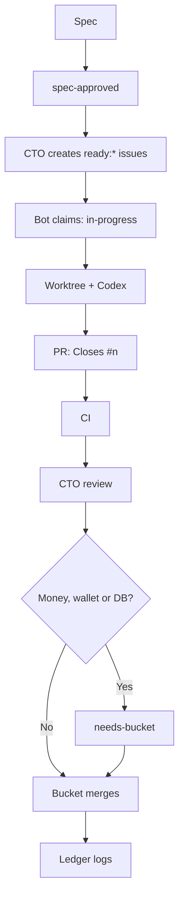

# AI-agent team onboarding

Start with the [spec flow](../specs/README.md), then use the guides below for daily work.

- [Git workflow](git-workflow.md): one worktree per issue, PRs and cleanup.
- [CI](ci.md): checks run by pull requests and their local equivalents.
- [Labels and flow](labels-and-flow.md): how work is approved, claimed and reviewed.
- [Repository map](repo-map.md): ownership areas and available package scripts.
- [Security](security.md): secrets, VPS access and model providers.

## Team roles

- **CTO:** owns architecture and reviews PRs; creates implementation issues from approved specs.
- **Backend Dev:** owns `packages/api`, database changes and Helius integration.
- **Frontend Dev:** owns the Expo app (`apps/hybrid-expo`) and Next app (`apps/web`).
- **Systems manager:** owns infrastructure and issues labelled `ready:system`.
- **Ledger:** keeps notes and the decision log.
- **Bucket:** founder and approver; the only person who merges PRs.

## Work flow

## Planned

- A deploy step owned by the systems manager, to be filed as a `ready:system` issue after #321 merges.
- Per-package typecheck scripts, to be filed as a `ready:system` issue after #321 merges; this must wait until the Expo TypeScript error at `apps/hybrid-expo/features/wallet/HomeWalletOverview.tsx:209` is fixed by a `ready:frontend` issue owned by the Frontend Dev.
