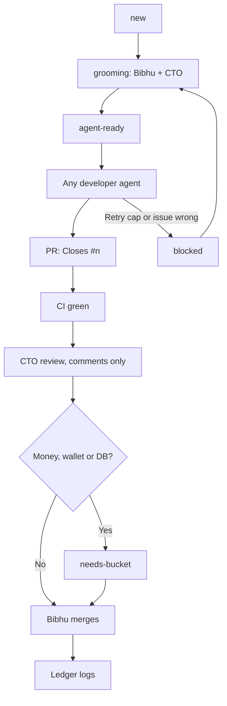

# AI-agent team onboarding

Start with [labels and flow](labels-and-flow.md), then use the guides below for daily work.

- [Git workflow](git-workflow.md): one worktree per issue, PRs and cleanup.
- [CI](ci.md): checks run by pull requests and their local equivalents.
- [Labels and flow](labels-and-flow.md): how an issue moves from `new` to merged.
- [Repository map](repo-map.md): ownership areas and available package scripts.
- [Security](security.md): secrets, VPS access and model providers.

## Team roles

- **Bibhu:** owner. Grooms issues with the CTO. The only person who merges PRs.
- **CTO:** grooms issues with Bibhu and reviews PRs with comments only.
- **CPO:** answers product questions while an issue is in grooming.
- **DB Guy:** reviews any migration.
- **UX Engineer:** reviews a PR that changes the UI.
- **Systems manager:** owns infrastructure.
- **Ledger:** keeps notes and the decision log.

Frontend Dev and Backend Dev are retired. Do not route work to them. Any developer agent picks up an `agent-ready` issue.

## Work flow

DB Guy also reviews any migration. The UX Engineer reviews a PR that changes the UI.

## Planned

- A deploy step owned by the systems manager, to be filed after #321 merges.
- Per-package typecheck scripts, to be filed after #321 merges. This waits until the Expo TypeScript error at `apps/hybrid-expo/features/wallet/HomeWalletOverview.tsx:209` is fixed.
