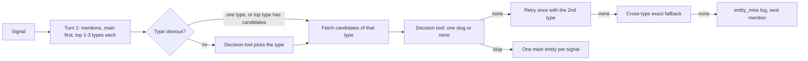

# @myboon/analyst (V4 analyst, issue #478)

The decider slot and signal claim state for the V4 analyst. The package owns no
tables: everything it touches is created by
`supabase/migrations/20261027120000_atlas_signal_status.sql`.

## What is here

- `src/states.ts` — claim a due signal (`claimNext`), finish it
  (`finishClaim`), record a failure (`failClaim`). Each is one call to an
  `atlas.signal_*` SQL function: a short committed transaction that clears the
  claim, so a crash is fenced by the claim token — the next `claimNext` picks
  the signal up again only after `claim_expires_at`.
- `src/deciders.ts` — `SystemOneDecider`, the Jev/Clef client (one POST per
  call to `/v1/systemone` with a `pick` choice question; the response model is
  pinned). `jevFromEnv()` and `clefFromEnv()` read `JEV_API_TOKEN` and
  `OLLAMA_API_KEY`; tokens are never logged or emitted. Failures map to
  `DeciderError` kinds: `out_of_credit` (HTTP 402), `timeout` (abort), `error`.
- `src/process.ts` — `processNext` ties it together: claim, build the case,
  run primary (Jev) and shadow (Clef) deciders in parallel, fall back to Clef
  when Jev errors/times out/is out of credit, then `finishClaim` with the
  decision row (full provenance: probabilities, runner-up margin, latency,
  decided_by, shadow answer) or `failClaim` with the last error.
- `src/runner.ts` — `runAnalystOnce` / `analystMain` (#512): one pass over due
  signals, one summary line, always ends the pool.
- `src/signal-worker.ts` (renamed from `d36-worker.ts` in #559) — the signal worker (#504): claim, one LLM session per
  signal with Jev/Clef as the decision tool, the sink, plus the standing rule
  that a signal older than 24 hours is parked `backlog_skip_24h` (#391) before
  the LLM runs. `PgDecisionSink` files at most one item per signal, on the
  first existing target, and never creates or proposes an entity (#567): other
  targets are dropped with a `target_dropped` log line. `pgCandidateLookup` is
  the read-only #566 candidate fetch.
- `src/session.ts` — the analyst session and type-first matching (#567, see
  below). `src/dry-run-matching.ts` is the read-only matching dry run.

## Entity matching (#567, type-first)

- Mentions are validated with zod (`analystMentionSchema` in `@myboon/contracts`).
- Candidates come from `atlas.entity_candidates(type, names)` (#566, active
  entities only, exact on `atlas.norm_alias`). `names` is the mention's name and
  search terms plus every 1-3 word phrase in the article. A type with at most
  `SMALL_TYPE_MAX` (25) active entities offers all of them. For `event`, active
  events with an item in the last `EVENT_WINDOW_DAYS` (7) days are added.
- The pick is a closed choice: candidate slugs plus `none`. An answer outside
  that list makes the signal `unclear`; no name is ever invented.
- The cross-type fallback (`atlas.entity_candidates_any`, mention names only)
  runs only after both typed tries miss.
- Mentions are tried in order; the first pick is the signal's one main entity.
- Never proposes: no code path inserts into `atlas.entities`. No CoinGecko, no
  embeddings, no pre-pass.
- A full miss logs one `entity_miss` line (see the RUNBOOK).

Dry run (read-only, needs the analyst env; nothing is written):
`pnpm --filter @myboon/analyst matching:dry-run --recent 20` or
`--ids id1,id2` or `--text "..."`, plus `--force-keep` to skip the keep gate.

- `src/item-wording.ts` (#559) — entity item title and summary. Title = the
  LLM's turn-1 `headline` (asked for at most 90 chars), or the summary's first
  whole sentence when there is none; never sliced. Summary = the signal
  summary, stored as `''` when it would just repeat the note. Both strip source
  lead-ins ("According to X,", "Per X:", "X reports that", "shared by X",
  "via @x"). The prompt in `session.ts` forbids naming the source, publisher,
  sharer or account; the source link stays on `atlas.signals.link`. Existing
  items are not rewritten.
- `src/catchup.ts` — the #391 one-off catch-up CLI (confirm-gated, Ollama
  quota guard, no new entities); `src/ollama-quota.ts` reads ollama.com's
  `/api/balance` for its quota guard.

There is no package entry point: `src/index.ts` was removed in #559 (nothing
imported `@myboon/analyst`). Import from the module that owns a symbol, and run
the CLIs via the `analyst:*` / `entity-manager:once` scripts.

## Configuration knobs (`src/config.ts`, all optional, positive integers)

- `ANALYST_MAX_SIGNALS_PER_RUN` — default **40** signals per run.
- `ANALYST_LEASE_MS` (default 300000, 5 min), `ANALYST_TIMEOUT_MS` (20000),
  `ANALYST_BACKOFF_MS` (60000), `ANALYST_MAX_ATTEMPTS` (3).
- `ANALYST_LLM_MODEL` (default `glm-5.3-flash`), `ANALYST_WORKER`
  (default `<hostname>:<pid>`), `ANALYST_SHADOW` (`true` enables the Clef shadow).

The analyst connects as `service_role` (only the granted columns and functions
exist to it). Jev and Clef are never contacted by the tests; see
`src/v4-status.db.test.ts` (local Postgres via `ANALYST_TEST_ADMIN_URL`) and
`src/deciders.test.ts` (fake fetch).

## Environment

- `ANALYST_DATABASE_CA_FILE` — optional PEM CA file the pool trusts instead of
  the bundled Supabase Root 2021 CA (`certs/supabase-prod-ca-2021.crt`).