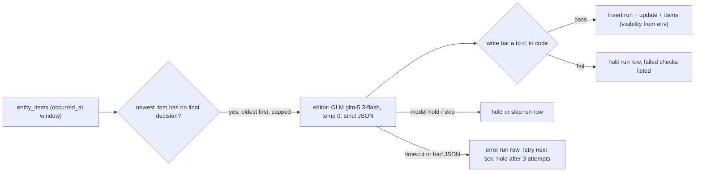

# @myboon/latest-updates (#631, part of #623)

Every 30 minutes, for each entity with a fresh item, the job asks one question: is this worth the reader's time now? It writes a **latest update**, **holds**, or **skips**, and records every decision. Rows are written `dark` until Bibhu says go. Nothing here is on by default: `LATEST_UPDATES_ENABLED` must be exactly `true`.



## Rules

| Rule | Where |
|---|---|
| **Window** is `entity_items.occurred_at` only: active entity, active item, not null, not in the future, within `LATEST_UPDATES_WINDOW_HOURS` (default 24). No override exists in the runner; only the length is tunable. Items that age out while the backlog drains are never published. | `store.ts` `CANDIDATES_SQL` |
| **Key** of a decision is (entity, newest eligible item by `occurred_at`). | `store.ts` |
| **Final per key.** A `published`, `hold` or `skip` run row is terminal; the entity is left out until a newer item arrives, so the model is not called again. The database enforces it (partial unique index on `latest_update_runs`). | `CANDIDATES_SQL`, `record()` |
| **Errors retry.** A timeout, failed call or bad JSON writes an `error` run row and nothing else. The attempt number is the count of `error` rows for the key plus one; the third failed attempt writes a `hold` with reason `retries_exhausted`. A newer item starts at attempt 1. | `record()` |
| **Cap.** `LATEST_UPDATES_MAX_PER_RUN` (default 25), oldest eligible first. | `CANDIDATES_SQL`, `runner.ts` |
| **Budget.** `LATEST_UPDATES_RUN_BUDGET_MS` (default 20 min): no new entity starts after it. Per-entity model timeout `LATEST_UPDATES_TIMEOUT_MS` (default 30 s). Concurrency `LATEST_UPDATES_CONCURRENCY` (default 2, max 4). | `runner.ts` |
| **One transaction per entity** (run row, and for a write the update and its items). A kill loses at most the entity in flight and never leaves half-written rows. A per-entity advisory lock stops two runs publishing the same entity at once. | `record()` |
| **Visibility is set at insert** from `LATEST_UPDATES_VISIBILITY` (`dark` default, or `live`). A bad value stops the run; it never falls back to `live`. The worker has no UPDATE grant. | `config.ts`, `runner.ts` |
| **Last update.** The entity's newest `latest_updates` row (dark or live) is "what we last published"; with none, the newest earlier item stands in. Items already linked to the last update are not "new" again. | `store.ts` `loadBundle` |

## Write bar (all four, in code; otherwise hold)

| | Check | How |
|---|---|---|
| a | **Novelty backstop.** `what_happened` holds a number, calendar date or named actor that is in the new items and not in the last update's text. | `checks.ts` `checkNovelty`. Numbers: the #612 tokens (years and dates masked). Dates: `Dec 10`, `10 December`, ISO. Actors: ALL-CAPS tickers and acronyms anywhere, and capitalised words that are not at the start of a sentence, minus a small stop list. |
| b | **Trace.** Every claim cites a supplied item id or origin signal id; every number in the draft appears in a supplied source (new items, earlier items, signals, the last update). | `checks.ts` (the #612 check, kept) |
| c | **`what_to_watch` is concrete:** a date, a price level or a decision. | `checks.ts` `checkWatch`. Date: month and day, ISO, numeric, a month name, Q1-Q4, H1/H2, FY, a weekday. Level: `$` amounts, k/m/b, comma-grouped, 4+ digit numbers (not years), percentages. Decision words: decision, vote, ruling, verdict, approval, deadline, hearing, meeting, FOMC, earnings, auction, election, summit, expiry, launch, filing. |
| d | **Period consistency.** Patterns: month names (full and 3-letter, optional year), Q1-Q4, H1/H2, FY25/FY2026. Held when the draft names a period no supplied source names; or the new sources give different periods for an indicator the draft mentions ("September CPI" vs "October CPI"); or the draft pairs a period with an indicator that the new sources name only for other periods. A figure the sources confirm ("September CPI, released in October") is not held. | `periods.ts`. A month inside a calendar date (`Dec 10`) is a date, not a period. `May` counts only after a preposition or before a year. `what_to_watch` is not checked for periods (it names the future; bar c covers it). |

These are heuristics. The eval set is where they are tested.

## Environment (names only; never values)

| Name | Default | Meaning |
|---|---|---|
| `LATEST_UPDATES_ENABLED` | off | Exactly `true` turns the job on. Off exits 0 before any config, database or model. |
| `LATEST_UPDATES_DATABASE_URL` | required when on | The `latest_update_worker` login (insert-only on the three new tables, SELECT on the four input tables). Non-local hosts verify TLS against `certs/supabase-prod-ca-2021.crt` (or `LATEST_UPDATES_DATABASE_CA_FILE`). |
| `OLLAMA_API_KEY` | required when on | Shared Ollama Cloud key. |
| `LATEST_UPDATES_LLM_MODEL` | `glm-5.3-flash` | |
| `LATEST_UPDATES_WINDOW_HOURS` / `_MAX_PER_RUN` / `_RUN_BUDGET_MS` / `_TIMEOUT_MS` / `_CONCURRENCY` / `_VISIBILITY` | 24 / 25 / 1200000 / 30000 / 2 / `dark` | See Rules. |

## Columns read

`atlas.entities` id, slug, name, type, summary, status. `atlas.entity_items` id, title, summary, note, angle, occurred_at, created_at, signal_id, status, main_entity_id. `atlas.item_signals` item_id, signal_id, role. `atlas.signals` signal_id, type, source, text, excerpt, numbers, link, occurred_at, created_at. Plus its own `latest_updates`, `latest_update_items` and `latest_update_runs`. The only writes are INSERTs into those three.

## Run and test

```
pnpm --filter @myboon/latest-updates test        # unit tests; the store/runner suite needs LU_TEST_ADMIN_URL (a LOCAL Postgres), else it is skipped
pnpm --filter @myboon/latest-updates typecheck
pnpm --filter @myboon/latest-updates eval        # the eval gate on eval/ (see below)
pnpm --filter @myboon/latest-updates once        # one real run; needs the gate on and both secrets in env. Not for local use against prod.
```

## Eval gate

`eval/` holds the frozen set from #629 (`snapshot.json`, `labels.csv` for Bibhu's `write`/`hold` labels). `src/eval.ts` runs the editor and the write bar over it and reports:

| Bar | Pass |
|---|---|
| untraced claims in published drafts | 0 |
| period mismatches in published drafts | 0 |
| agreement with labels | at least 80% |
| hold-recall (of `hold` labels, the job did not publish) | at least 80% |
| timeouts after retry (3 attempts) | under 5% |

A `write` label means publish; model hold, model skip and a write the bar holds all count as `hold`. Drafts the gate had to hold are reported next to the published counts, so you can see how often the code stepped in. With `labels.csv` blank the script says `CANNOT SCORE`, still reports what needs no labels if a model key is set, and exits 0 (it never fails CI). A scored FAIL exits 1; bad input exits 2. The model run needs `OLLAMA_API_KEY` in the environment.

Freezing a new set can use a window override that exists **only** here: `tsx src/eval.ts --print-freeze-sql --hours 72 --basis created_at --until 2026-11-14T01:00:00Z [--slugs a,b]` prints a read-only SELECT (`freeze.ts`). The runner never imports it (a test pins that). Rerun the eval on every prompt or model change and post the result on #623.
